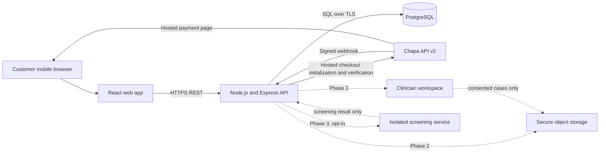
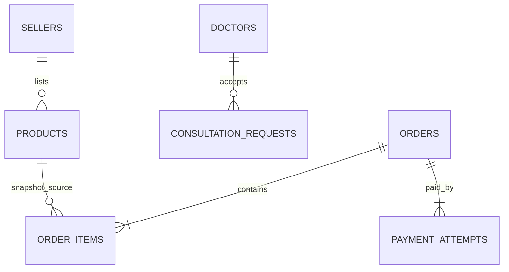

# Beauty Face system design

## Architecture

The browser never computes the authoritative order total or decides that payment succeeded. The API recalculates price and stock from PostgreSQL, creates a unique merchant reference, requests Chapa checkout, and verifies the returned transaction before marking an order paid. Payment webhooks are authenticated against their exact raw body and trigger server-side verification. Only then can fulfillment begin.

## Stack and boundaries

- **Frontend:** React with Vite; responsive, mobile-first, local cart state, English-first copy.
- **Backend:** Node.js 20+ and Express 5 REST API; input bounds, rate limits, security headers, server-only provider keys.
- **Database:** PostgreSQL; parameterized queries, transactional order creation, encrypted PII blobs, catalog indexes.
- **Payments:** Chapa v2 hosted checkout in ETB. Secret is configured on the API only. Test mode precedes any live key.
- **Delivery configuration:** city allow-list and fee estimates are stored in PostgreSQL and editable in the admin workspace, with environment values as a fallback. The order API independently validates the selected city and recalculates its fee.
- **Admin access:** password-protected Express routes use scrypt password hashes, expiring HttpOnly sessions, CSRF checks, same-origin checks, a login rate limit, and audit events. Every active admin currently has full privileges.
- **Later services:** object storage for consented clinical images; separate inference service for opt-in screening; video/chat provider after clinical operations and privacy design.

## Data model

Implemented tables in `database/migrations/001_initial_schema.sql` and `002_admin_console.sql`:

| Table | Purpose | Key relationships |
|---|---|---|
| `sellers` | Supplier identity and verification state | One seller to many products |
| `doctors` | Clinician profile and license verification state | One doctor to many consultation requests |
| `products` | Catalog, label metadata, expiry information, price, stock, supplier status | Optional seller reference |
| `consultation_requests` | Minimal, consented callback pilot request | Optional assigned doctor; contact is encrypted |
| `orders` | Server-priced order, encrypted customer/address fields | One order to many items and payment attempts |
| `order_items` | Immutable product name, quantity, and price snapshots | Belongs to an order; optional live product reference |
| `payment_attempts` | Chapa merchant reference and verified payment state | Belongs to an order |
| `webhook_receipts` | SHA-256 digest for duplicate delivery detection | Unique by provider and payload digest |
| `customers` | Encrypted customer contact, lookup hash, and account status | One customer to many orders |
| `admin_users` | Administrator identities and password hashes | One admin to many sessions and audit events |
| `admin_sessions` | Hashed session token, CSRF token, and expiry | Belongs to an administrator |
| `articles` | Public education content and publication status | Created and updated by admins |
| `app_settings` | Delivery area/fee and public site settings | Updated by admins |
| `delivery_riders` | Encrypted rider phone and operational status | One rider to many delivery assignments |
| `delivery_assignments` | Order-to-rider assignment and delivery status | Belongs to an order, rider, and assigning admin |
| `safety_reports` | Encrypted public product-safety concern and optional contact | Optional product and order references |
| `audit_events` | Administrator action history | Optional administrator reference |

Planned before later features: `users` and `role_assignments`; `seller_documents`; `product_lots` with batch, expiry, and source evidence; `consent_records`; `scan_sessions` storing only an encrypted object reference and purpose/retention metadata; `clinical_cases`, `clinical_notes`, `appointments`, and `messages`. Do not store face or body images in PostgreSQL.

### Data handling

- Customer contact and delivery objects are encrypted with AES-256-GCM before insertion. Set a 32-byte `PII_ENCRYPTION_KEY`; production should use a managed key service and rotation plan.
- No photos, diagnostic notes, free-text symptoms, or clinical records are collected by this initial web build.
- Product rows are marked as sample listings and have a pending supplier verification state. Demo rows must be replaced with evidence-backed listings before commerce launch.
- The sample checkout deducts stock when an order is created. A production release needs reservation expiry, payment-timeout handling, cancellation/refund, and stock-restoration workflows before it handles real inventory.
- PII encryption in application code does not remove the need for TLS, database encryption at rest, backups, access controls, monitoring, retention rules, and legal review.

## API surface

| Method | Endpoint | Purpose |
|---|---|---|
| `GET` | `/api/health` | API and database readiness |
| `GET` | `/api/config/public` | Configured delivery cities and fee estimates |
| `GET` | `/api/products?q=&category=&skinType=&concern=` | Search and filter published products |
| `GET` | `/api/products/:slug` | Product details |
| `POST` | `/api/orders` | Validate cart/address, price from database, create order, initialize Chapa, return checkout URL |
| `GET` | `/api/orders/:id/payment-status` | Verify status server-side after hosted checkout redirect |
| `POST` | `/api/webhooks/chapa` | Authenticate raw-body signature, deduplicate event, verify payment, update state |
| `POST` | `/api/consultation-requests` | Submit a minimal consented pilot callback request |
| `GET` | `/api/articles` | Read published public education articles |
| `POST` | `/api/safety-reports` | Submit a rate-limited, consented encrypted product-safety report |
| `POST` | `/api/admin/auth/login` | Sign in and create an expiring admin session |
| `GET` | `/api/admin/auth/session` | Check the active admin session and CSRF token |
| `POST` | `/api/admin/auth/logout` | Revoke the current admin session |
| `GET/PATCH` | `/api/admin/*` | Authenticated admin console operations for catalog, partners, customer records, fulfillment, content, settings, and access control |

Planned endpoints include OTP registration/session refresh; account and deletion requests; seller product submission and evidence; availability and appointment booking; clinician case access; consent management; rider self-service; customer order history; refunds; and scan-session consent/upload/result. Add distinct roles before giving external sellers, clinicians, riders, or support staff access to records.

## Payment sequence

1. Browser submits product UUIDs, quantities, customer contact, and city-specific address fields.
2. API validates bounds, opens a PostgreSQL transaction, locks product rows, checks stock, snapshots prices, creates the order and a unique Chapa merchant reference, and commits.
3. API calls Chapa hosted checkout with an idempotency key and returns only the checkout URL and non-sensitive order status.
4. Browser redirects to the hosted page. Chapa redirect and webhook are signals, not proof of payment.
5. The return page calls the status endpoint. API calls Chapa verify and matches `SUCCESS`, `merchant_reference`, amount in integer cents, and currency `ETB` before setting `paid`.
6. A webhook is checked with HMAC-SHA256 over the raw body using `x-chapa-signature`, compared in constant time, deduplicated, and verified server-side before applying the same state transition.

## Future image flow

1. Explain use, limitations, retention, sharing, and deletion; request separate opt-in consent before capture or upload.
2. Give photo guidance and allow the user to stop or delete. Strip unnecessary metadata and encrypt transport and storage.
3. Send only an opaque, authorized object reference to an isolated screening service. Keep its output as triage and uncertainty, not diagnosis.
4. Abstain on poor image quality or unsupported cases and offer a human referral path.
5. Record consent version, access, model version, and deletion. Evaluate subgroup performance across dark skin tones and Ethiopian users before release.
